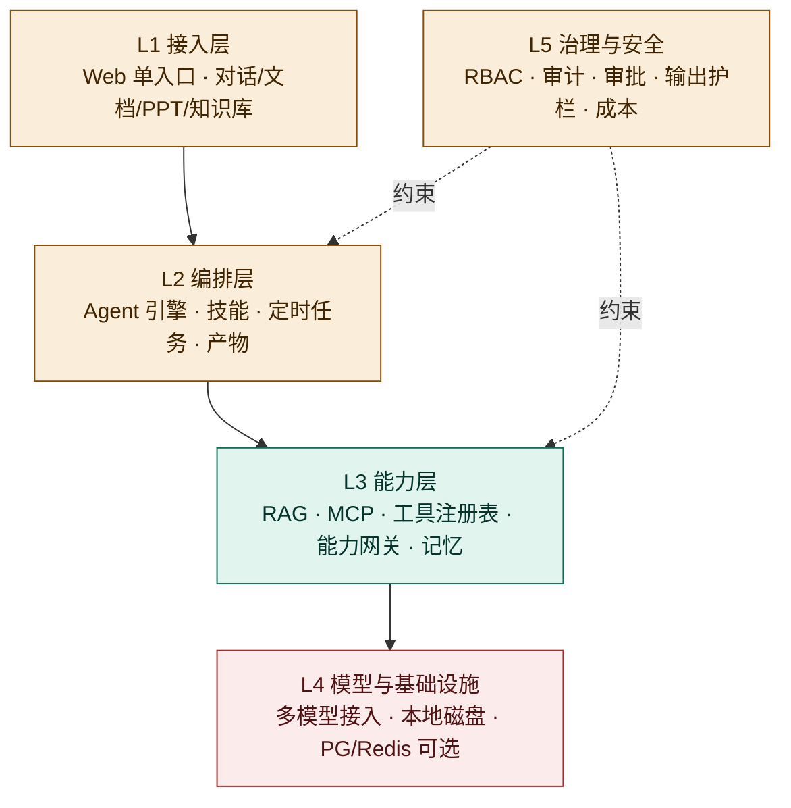
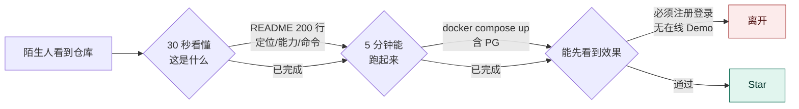
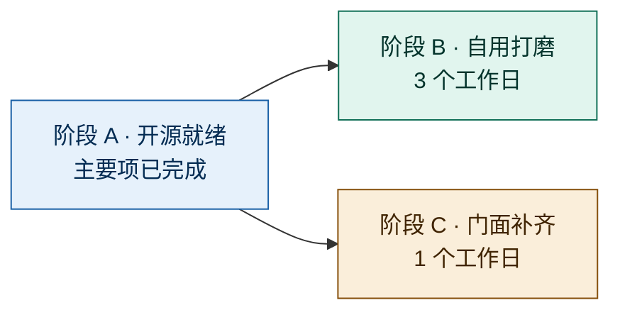

# 项目评估 · 自用与开源就绪度

> 初评：2026-11-13｜对象 v8.11.0｜复核：2026-11-13 晚｜对象 v8.21.1（`a3c8471`）
> 口径：**只写能在代码里指出位置、或能现场跑出来的结论**。推断项单独标「推断」。
> 与前序评估的关系：`优化评估-v8.md` 查的是「代码有没有毛病」；本篇查的是「**这个项目作为自用工具 / 开源作品，分别够不够格**」，两者判据不同，结论也不同。

---

## 结论摘要

1. **自己用：够。** 已是可用成品，只差三件运维动作（备份、升级、对象存储），不影响日常使用。
2. **开源就绪：门面关口已全部关闭。** 初评时列出的四个 P0（LICENSE、README 结构、CI、仓库名）在同日的 v8.20 里已逐个落地：Apache-2.0 已加、README 从 561 行压到 204 行、`.github/workflows/ci.yml` 已跑、仓库改名 `hexcore`。现在缺的是**体验层**（在线 Demo、截图）而不是资格。
3. **数据面：已清三轮。** 演示素材（134 张截图、培训手册、业务样表）全部移出，提交历史经三轮重写后敏感词零命中、图片零张，仓库重建以清除指向旧历史的 PR 引用。

> 一句话：**它已经从「个人开发日志」变成「一个能公开的项目」，剩下的是让人愿意点进来。**

---

## 一、评估方法与边界

| 维度 | 做法 | 覆盖 |
|---|---|---|
| 代码规模与结构 | 统计文件数、行数、表数、路由数、模块职责 | 全仓 |
| 工程健康度 | **实跑 `npx tsc --noEmit`**（结果见 §二） | 全仓 |
| 质量资产 | 清点单测、评测集、迭代记录 | `tests/` `evals/` `docs/` |
| 仓库卫生 | 查 `.gitignore`、`git ls-files`、敏感文件是否入库、`git log -- .env.local` | 386 个入库文件 |
| 部署形态 | 读 `Dockerfile` / `docker-compose.yml` / 环境变量模板 | 部署链路 |
| 外部对标 | 检索 2026 年同类平台的市场与采购口径 | 参考，不作结论依据 |

**明确不在本轮范围**：多租户 SaaS 化、计费体系、等保/信创资质。这些是商业化路径的 P0，但**当前两个目标都不需要**，故降级为「非目标」，避免把精力花在卖不出去的功能上。

**未做的**：未跑真实模型回归（本机 Key 状态不定）、未做压力测试、未在第二台机器验证安装流程（这条恰好是开源最大的未知数，见 §八）。

---

## 二、事实基线

| 项 | 实测值 | 说明 |
|---|---|---|
| 代码量 | `app/` 16,745 行 · `lib/` 15,885 行 · `components/` 3,450 行 | 合计约 3.6 万行，300 个 TS/TSX |
| 路由 | 90 个 `route.ts` · 18 个页面 · 47 个 TSX | 业务域覆盖完整 |
| 数据模型 | 32 张表 | `lib/schema.ts` |
| 治理模块 | `lib/agent/` 21 个模块 | 护栏/校验/成本/幂等/健康度 |
| 类型检查 | `npx tsc --noEmit` → **0 错误** | 复核时实跑 |
| 单测 | 67 文件 / **956** 个用例（949 通过 · 7 跳过），15.7s | 与 `evals` 分离，纯函数无网络。**注意：用 `grep "it("` 只能数到 765，`it.each` 展开的算不出来，必须实跑** |
| 评测集 | golden **56** 条 · adversarial **20** 条 | 真库真模型，约 4 分钟 |
| 发布 | **34 个 tag**（v7.6.0 起）· **240 次提交** | v8.0 起 CHANGELOG 完整 |
| 开发周期 | 首次提交 **2026-10-16** → 复核日 **28 天** | 见 §4.3 |
| 入库文件 | 386 个，`docs/` 4.1 MB，`.git` 5.3 MB | 初评时 717 个 / 27 MB / 29 MB，瘦身来自移除 134 张截图与 `qa/` |
| 类型债 | `: any` / `as any` 共 **584 处** | ⚠️ 见下方提示 |

> ⚠️ **一个被忽略的趋势**：`优化评估-v8.md`（2026-10-27）记录当时是 **302 处** `any`，17 天后涨到 **436 处**（+44%），而 `tsconfig` 仍是 `"strict": false`。复核时已到 **584 处**。这意味着「tsc 0 错误」这句话的**说服力在下降**——它不是变好了，是检查变松了。这条不建议现在修（成本 3–5 天且不产生可见价值），但**对外讲的时候不要把它当成质量证据**。

---

## 三、分层就绪度（L1–L5）



| 层 | 状态 | 依据 | 对两个目标的影响 |
|---|---|---|---|
| L1 接入 | 部分 | 只有 Web；无 API 网关/开放平台/多端 | 自用足够；开源 demo 需公网可访问，是缺口 |
| L2 编排 | 部分 | 引擎/技能/调度齐全；调度是进程内 cron | 自用足够；开源无影响 |
| L3 能力 | **强** | 33 条 Agent 能力逐条落点，见 `docs/02-设计/Agent能力矩阵.md` | **两个目标的核心资产** |
| L4 基础设施 | **阻断** | `lib/storage.ts` 仅 24 行本地路径，无存储抽象 | 自用需手动备份；开源需说明「单机部署」 |
| L5 治理 | 部分 | 护栏/审计/审批强；无 SSO、无多租户 | 自用/开源**都不需要** SSO |

**关键判断**：L4 的「阻断」是冲着商业化去的，对当前两个目标只是「**需要写清楚的一条限制**」，不是必须修。这个区分很重要——上一轮把它列为 P0 是站在卖 SaaS 的立场，现在立场变了，优先级必须跟着变。

---

## 四、两个目标逐项判定

### 4.1 自己用 —— 够用，缺 3 件运维动作

**已具备**：Dockerfile 非 root + healthcheck + standalone 产物；`docker-compose.yml` 一键起 PG/Redis；无 Redis/pgvector 时全链路自动降级（`README.md`「零中间件运行记录」）；`/api/health` 探针可用。

**缺的三件**（都不是功能，是运维）：

| # | 缺什么 | 现状 | 后果 | 成本 |
|---|---|---|---|---|
| A | 备份/恢复 | `scripts/` 只有重置数据、密钥重加密、发布 | 误删知识库 = 不可恢复 | 半天（`pg_dump` + `data/files` tar 打包脚本） |
| B | 升级流程 | 靠手工看 CHANGELOG + 重建容器 | 跨版本升级可能踩 DDL | 半天（写进 README 的升级检查单） |
| C | 对象存储（可选） | `lib/storage.ts` 写死本地盘 | 换机器要手动搬 `data/files` | 1 天（加 adapter，暂只实现 local + S3） |

> 这三件不做也能用，但**A 不做风险最高**：一次误操作就是真实数据损失。

### 4.2 开源 —— 资格已够，缺的是「让人愿意点进来」

涨星的机制不是「功能多」，是**陌生人 3 分钟内能判断「这跟我有关」并跑起来**。初评时这条路径断了四处，现在三处已修：



| 断点 | 初评状态 | 现在 |
|---|---|---|
| ① README 是开发日志 | 561 行里 487 行（87%）是 v2→v8 升级流水 | **已解决**：重写为 204 行，历史搬进 `CHANGELOG.md` 与 `docs/03-迭代/` |
| ② 上手门槛高 | 需要 PG + 至少一个模型 Key | **已解决**：`docker compose up` 全栈（含 PG），演示模式无需真实 Key |
| ③ 看不到效果 | 无在线 Demo、无 GIF；截图含真实业务痕迹 | **半解决**：泄漏素材已全部移除，但**新的空态截图尚未补** |
| ④ 无社区门面 | 无 LICENSE、无 CONTRIBUTING、无 CI | **已解决**：Apache-2.0 + CONTRIBUTING + `.github/workflows/ci.yml` |

**结论**：开源这件事，代码与门面都已经够了，**差的是「一眼能看到它长什么样」**——一个在线 Demo 或 5 张干净截图。

### 4.3 关于「28 天 3.6 万行」

首次提交是 2026-10-16，到本篇复核（2026-11-13）只有 **28 天、240 次提交、3.6 万行、956 个测试用例**。

这个速度必然引来一个疑问：「这是 AI 生成的吗？」**这个疑问是合理的**，人不借助 AI 几乎不可能在 28 天内产出这个量。所以本项目不把「体量」当质量证据，**对外只主张三件事**：判断链条能复述、错误有记录、结论可复跑。具体做法是每条主张都指向一个文件或一条命令，见 §五。

---

## 五、可举证的优势（每条都能当场打开文件）

| # | 优势 | 位置 | 为什么稀缺 |
|---|---|---|---|
| 1 | **运行时治理闭环** | `lib/agent/` 21 模块：`output-guard.ts`（流式硬护栏）、`runtime-verify.ts`（确定性校验）、`channel-health.ts`、`quality-alert.ts` | 多数开源平台只做「记录日志」，不做到「请求路径上拦截 + 劣化主动告警」 |
| 2 | **评测器自身被评测** | `evals/judge.test.ts` + `golden.jsonl` 56 条 + `adversarial.jsonl` 20 条 + `trend.mjs` | 「评测器会误判」这件事，绝大多数项目不承认，更不会写回归 |
| 3 | **中文 RAG 的脏活记录** | `docs/03-迭代/版本演进记录-v2到v8.md`（v7.6 分块碎片化、v7.7 小数点当句末） | 这类坑只能在真实中文语料上踩出来，文档里带根因与数据 |
| 4 | **全链路可降级** | `lib/redis.ts` 内存限流兜底；`lib/ai/embed.ts` 哈希向量兜底 | 「依赖缺失不导致请求失败」是生产级要求，个人项目极少做到 |
| 5 | **多通道对称** | `lib/agent/channel-verify.ts`：对话/技能/定时任务共用同一套校验与护栏 | v8.3–v8.6 连续四轮修的就是「只有对话有防护」，这是架构自觉 |

---

## 六、缺口清单

> 与 `优化评估-v8.md` 的区别：那份按「代码风险」排序；这份按「**对自用/开源的阻碍程度**」排序。同一问题在两份里优先级不同是正常的——判据变了。

### 已关闭（初评为 P0，同日完成）

| # | 问题 | 关闭方式 |
|---|---|---|
| P0-1 | 无 LICENSE | 已加 **Apache-2.0**（含专利授权 + 商标条款，企业敢用且愿提 PR） |
| P0-2 | README 结构错位（561 行 / 87% 是升级流水） | 重写为 **204 行**：定位 → 三条命令 → 能力 → 治理层 → 质量数字 → 文档导航 |
| P0-3 | 无 CI | `.github/workflows/ci.yml` 跑 `npm run ci`（typecheck + lint:ui + test + docs:check） |
| P0-4 | 仓库名无辨识度 `hexcore` | 改名 **`hexcore`**（短、可搜、与「核心能力层」定位一致） |
| P0-5 | `qa/` 165 个快照文件入库、`docs/` 27 MB | `qa/` 整个移除；134 张截图与其所属手册删除；`docs/` 降到 4.1 MB |

### P1 · 开源体验（仍开放）

| # | 问题 | 证据 | 修法 |
|---|---|---|---|
| P1-1 | **无在线 Demo** | 首屏 `redirect('/login')`；无公网实例 | 涨星最大的转化杀手：别人不愿为了看一眼而装 PG。可选：托管一个只读演示实例，或用 30 秒 GIF 替代 |
| P1-2 | 首屏无截图 | 旧截图（含真实业务痕迹）已移除，新图未补 | 重新截 5 张**空数据状态**的图放 README 顶部 |
| P1-3 | 无 Issue / PR 模板 | 有 `CONTRIBUTING.md`，缺 `.github/ISSUE_TEMPLATE` | 两个 md 文件，半天 |
| P1-4 | 上手仍需手填模型 Key（可选） | 演示模式已可零 Key 跑 | 在 README 把「零 Key 演示」提前到第一屏 |

### 明确不做的

| 项 | 为什么不做 |
|---|---|
| 多租户 / 计费 / SSO | 两个目标都不需要；做了也没有人验收 |
| 开 `strict: true` | 3–5 天，584 处 `any`，不产生可见价值；**但对外别把 tsc 0 错误当质量证据** |
| 拆 `app/api/chat/route.ts`（811 行） | 可当「已知技术债」讲，重构收益低于成本 |
| 迁移工具（换掉 `lib/db.ts` 自建 ALTER） | 自用无感；开源初期反而增加上手门槛 |

---

## 七、归属与数据安全

> 为什么单列一节：开源前真正容易出事的，不是协议选哪个，而是两件更朴素的事——**这些东西到底归谁**，以及**有没有把不该出去的内容带出去**。本节给结论，也给一套可复用的检查清单。

### 7.1 归属：三种权利必须分开谈

「别人能不能把这个当成他的项目」这句话含两种完全不同的意思，法律后果相反：

| 状态 | 著作权 | 独占权 | 别人能做什么 | 你还有什么 |
|---|---|---|---|---|
| **私有** | 你 | 有 | 拿不到源码，不能合法使用 | 完整控制 |
| **MIT / Apache-2.0（当前）** | **仍是你的** | **放弃** | fork、商用、闭源二次分发、改名做产品；不能删版权声明、不能用你的项目名 | 名分 + 商标 + 首发身份 |
| **AGPL** | 仍是你的 | 放弃（但传染） | 同上，但衍生作品必须开源 | 名分 + 挡住闭源商用 |

- **「这代码是我写的」** → 开源后仍是你的权利，去掉 Copyright 即侵权。
- **「我基于它做了个产品，叫 XX」** → 完全合法，这是开源的正常生态（Dify、FastGPT 都是这样被用的）。

**诚实的一句**：开源保得住「名分」，保不住「独占」；而且名分被侵犯时，现实里维权成本高于收益，不要抱幻想。

**主导权的真实来源是这四样，与协议无关**：① **商标**（开源协议明确不授权商标，这是唯一能硬性阻止「被冒充」的东西）；② 首发者身份；③ 持续提交（fork 出去没人维护就死了）；④ 你掌握 roadmap 与文档。

### 7.2 已核实的有利事实

| 项 | 核实结果 | 命令 |
|---|---|---|
| 提交身份 | **个人邮箱**（gitee noreply），非公司邮箱 | `git config user.email` |
| 代码/文档含公司名 | **零命中** | 全仓 grep 公司名与客户名 |
| `data/` 是否入库 | **0 个文件** | `git ls-files data` |
| `.env.local` 是否曾提交 | **从未** | `git log --all -- .env.local` |

> 结论：**代码本身是干净的**，归属风险不来自代码。

### 7.3 唯一的法律风险：职务作品

代码干净 ≠ 没有风险。真正的变量是**劳动合同的知识产权条款**。不少合同写着「任职期间的一切发明创造归单位所有」，这类条款的效力有争议，但足以让开源动作变麻烦。

判断通常看三点：**是否属于本职工作、是否使用公司资源、是否在工作时间**。建议动作：

1. 翻一遍劳动合同与保密协议里的 IP / 竞业条款；
2. 若条款表述宽泛，**开源前先书面确认**，不要在模糊状态下公开；
3. 项目首次提交时间、个人邮箱、个人设备，都是「非职务作品」的有力佐证，保留好。

### 7.4 数据面：四个层级，最危险的不是 git

这是本次评估里最容易被低估的部分。真实数据可能存在于四个地方，**它们在开源时的暴露路径完全不同**：

| 层级 | 载体 | 会随开源泄漏吗 | 说明 |
|---|---|---|---|
| 磁盘文件 | `data/files/` | **否** | `.gitignore` 已排除；但**演示时会在界面上显示** |
| 数据库记录 | `files` / `artifacts` 表 | 否 | 库在本地，但只删磁盘不删记录 → 点开 404 的悬空项 |
| 向量库 | `documents` / `chunks` | 否 | 一旦入库，**内容已被切块 + 向量化**，是被忽视的泄漏面 |
| 聊天记录 | `messages` | 否 | 对话里可能粘贴过业务原文，**录屏时点开旧会话就出去了** |

**核心判断**：`git push` 不会带出这些数据，所以「仓库干净」是必要但不充分的。真正的高危场景是**演示**——录屏、截图、公网 Demo 实例，会把界面上的真实内容带出去。这类材料一旦流出，性质和开源代码完全不同。

### 7.5 开源前数据安全检查清单（可复用）

```bash
# 1. 敏感目录是否入库
git ls-files data | wc -l          # 应为 0

# 2. 密钥是否进过历史
git log --all --oneline -- .env.local .env   # 应为空

# 3. 扫描上传目录，注意容易漏的扩展名
find data -type f \( -iname "*.xls" -o -iname "*.doc" -o -iname "*.csv" \
  -o -iname "*.pdf" -o -iname "*.md" -o -iname "*.txt" \)

# 4. 数据库三张表
#    files / artifacts / documents(+chunks) 逐个按文件名核对

# 5. 聊天记录
#    SELECT count(*) FROM messages WHERE content LIKE '%<业务关键词>%'
```

> **本次实测踩到的坑，两条值得记住**：
> 1. **只扫 `*.xlsx` 会漏掉 `.xls`** —— 真实业务表格恰恰是老格式。扩展名必须写全。
> 2. **磁盘文件 ID 与数据库主键不是同一套**（文件名前缀 `art_xxx` vs 表主键 `artifact_xxx`），按 ID 删会漏一半，**必须按 filename 匹配**。

### 7.6 本次清理记录（脱敏）

> 具体文件名与地名不写入本仓库——本文档本身会进 git，写进去等于二次泄漏。

| 类别 | 数量 | 处置 |
|---|---|---|
| 外部机构接口手册 | 1 | 移出 + 删记录 |
| 外部机构周报（PDF） | 1 | 移出 + 删记录 |
| 内部需求文档（86 KB） | 1 | 移出 + 删记录 |
| 区域业务数据表 | 1 | 移出 + 删记录 |
| 业务参数说明 | 1 | 移出 + 删记录 |
| 业务周报 / 政策类产物 | 5 | 移出 + 删记录 |
| **合计** | **10 个文件** | 10 条 DB 记录、2 篇知识库文档、11 个向量块 |

**代码侧另做三轮历史清洗**（起因是演示截图与一份第三方协议说明误入仓库）：

| 轮次 | 动作 | 结果 |
|---|---|---|
| 1 | 删截图目录（含旧路径同名文件）、删协议说明与相关代码 | 文件树干净 |
| 2 | `--replace-text` 替换正文中的敏感词与业务术语 | 全历史 15 个敏感词各 0 处 |
| 3 | `--invert-paths` 清残留路径 + `--replace-message` 改提交信息 | 提交信息、路径、内容三项全 0 |

**一条容易漏的经验**：`refs/remotes/origin/*` 会让旧提交在本地仍然可达，`rev-list --all` 因此「清不干净」——必须删对应 ref 再 `gc --prune=now`。另外**远端平台会保留 `refs/pull/N/*`**，它们指向合并前的旧提交，即使分支已删也取得到；要彻底断开只能**删库重建**。

### 7.7 演示纪律（比清理更重要）

清理是一次性的，演示是持续的。做 Demo / 录屏 / 公网实例时固定遵守：

1. **用独立账号**，不要用日常账号；
2. **知识库留空或只放公开文档**；
3. **不要点旧会话**——侧边栏标题安全，正文不安全；
4. 截图前检查文件列表、产物列表、最近会话三处；
5. 公网 Demo 实例**定期重置数据库**（已有 `scripts/reset-all-data.mjs` 可用）。

---

## 八、开源专项体检

| 检查项 | 状态 | 说明 |
|---|---|---|
| LICENSE | ✅ Apache-2.0 | 含专利授权 + 商标条款；**不建议 AGPL**——目标是涨星不是防云厂商白嫖，AGPL 会挡住一半企业用户 |
| README | ✅ 204 行 | 定位 → 三条命令 → 能力 → 治理层 → 质量数字 → 文档导航 |
| CI | ✅ 已配 | `.github/workflows/ci.yml` 复用 `npm run ci` |
| CONTRIBUTING | ✅ 已有 | 含分支模型与提交规范 |
| `.gitignore` 完整性 | ✅ 已到位 | `data/`、`.env.local`、`test-results/`、`docs/06-参考/reference/` 全部排除 |
| 密钥是否入库 | ✅ 从未提交 | `git log --all -- .env.local` 为空 |
| 运行态文件是否入库 | ✅ 干净 | `git ls-files data` = 0，`test-results` = 0 |
| 历史残留 | ✅ 已清 | 敏感词 0、图片 0、旧路径 0 |
| 在线 Demo | ❌ 缺失 | 见 P1-1 |
| 首屏截图 / GIF | ❌ 缺失 | 见 P1-2 |
| Issue / PR 模板 | ❌ 缺失 | 见 P1-3 |

> **这一节的结论值得单独说**：仓库卫生做得比多数开源项目好——敏感文件一个没漏、`data/` 一个没进。**这意味着开源不需要「清理历史」这种痛苦操作**（虽然本次因为演示素材还是做了三轮），是纯粹的新增工作量。

---

## 九、路线图



| 阶段 | 内容 | 验收标准（可判定） |
|---|---|---|
| **A · 开源就绪**（已完成） | Apache-2.0 LICENSE；README 重写；CI；CONTRIBUTING；改名 `hexcore`；`docker compose up` 全栈 | ① 全新机器 `git clone && docker compose up` 10 分钟内出登录页；② CI 绿标可见；③ README 前 50 行不含版本号 |
| **B · 自用打磨**（3 天） | 备份/恢复脚本（`pg_dump` + `data/files`）；升级检查单；`lib/storage.ts` 加 adapter（local/S3） | ① 能在空库上恢复出一份完整数据；② 备份脚本有对应的还原验证步骤 |
| **C · 门面补齐**（1 天） | 5 张空态截图 + 一段 GIF；Issue/PR 模板；README 首屏放「零 Key 演示」 | ① 首屏 3 屏内能看到界面；② 截图与 Demo 中无任何真实业务内容 |

**顺序理由**：A 已完成，C 决定别人会不会点进来，B 只服务自己用——而自己用现在就能用。

---

## 十、风险

| 风险 | 可能性 | 应对 |
|---|---|---|
| 开源后无人 star | 中 | 涨星靠「一句话定位 + 可跑 demo + 一个别人没有的点」。本项目的「点」是**治理与评测**，需在 README 第一屏就点明，而不是列 20 个功能 |
| 开源后收到无法维护的 Issue | 中 | 明确写「单机部署，不支持多副本」，把能力边界前置，减少预期错配 |
| 被质疑是 AI 批量生成 | 中 | 不拿体量当证据；只主张「判断可复述、错误有记录、结论可复跑」，见 §4.3 |
| README 重写丢失历史 | 低 | 历史全部已在 `CHANGELOG.md` 与 `docs/03-迭代/`，README 只是入口，不承载历史 |
| **劳动合同的 IP 条款**把项目划为职务作品 | 低—中 | 见 §7.3：翻合同、看「本职工作 / 公司资源 / 工作时间」三要素；条款宽泛时先书面确认再公开。**这是唯一无法靠技术手段消除的风险** |

---

## 十一、待确认

1. **是否投入一次公网 Demo？** 这是涨星转化率最高的一项，但需要一台常驻机器 + 模型额度预算。
2. **劳动合同的 IP 条款确认了吗？** 这是 §七 里唯一无法用技术手段解决的一项，建议在公开仓库**之前**完成。
3. **`messages` 表里的历史对话要不要清？** 若要做公开 Demo，建议按 §7.5 第 5 步过滤或直接换新库。
4. **截图从哪里来？** 空态截图需要一套全新账号 + 空知识库，否则会重蹈「截图带业务痕迹」的覆辙。

---

> 相关文档：[`优化评估-v8.md`](优化评估-v8.md)（代码风险视角）｜[`Agent能力矩阵.md`](../02-设计/Agent能力矩阵.md)（能力→代码对照）｜[`CHANGELOG.md`](../../CHANGELOG.md)（逐版变更）
